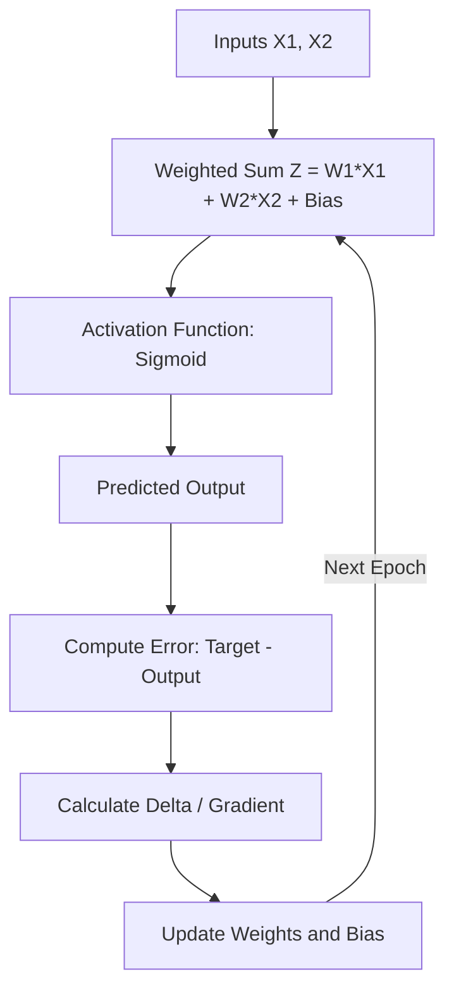
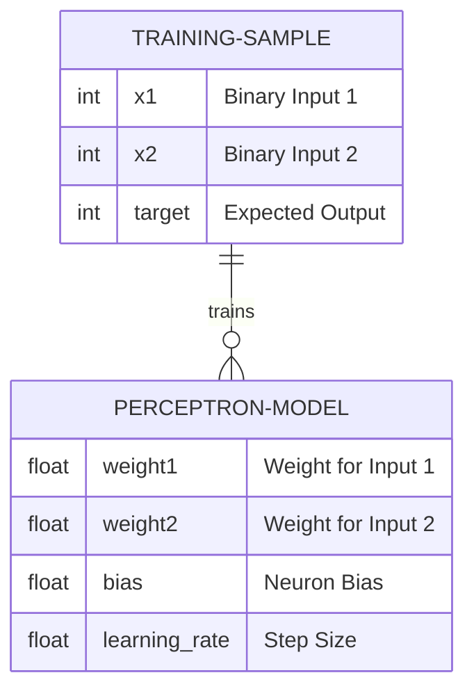

# Single-Layer Perceptron AND Gate Implementation


A lightweight, dependency-free Python implementation of a Single-Layer Perceptron trained to solve the logical **AND gate** problem from scratch using manual forward pass, mean squared error loss, and backpropagation.

---

## 📋 Table of Contents
- [Description](#-description)
- [Purpose of This Project](#-purpose-of-this-project)
- [Features](#-features)
- [Requirements](#-requirements)
- [File Structure](#-file-structure)
- [Installation](#-installation)
- [Setup & How to Use](#-setup--how-to-use)
- [System Diagrams](#-system-diagrams)
  - [Data Flow Diagram (DFD)](#data-flow-diagram-dfd)
  - [Entity-Relationship (ER) Diagram / Model Representation](#entity-relationship-er-diagram--model-representation)
- [Who Can Use This](#-who-can-use-this)
- [Use Cases](#-use-cases)
- [Pros and Cons](#-pros-and-cons)
- [Limitations](#-limitations)
- [Known Bugs & Vulnerabilities](#-known-bugs--vulnerabilities)
- [Future Updates](#-future-updates)
- [Contributing](#-contributing)
- [Star & Support](#-star--support)
- [Thanks](#-thanks)

---

## 📖 Description

This project demonstrates the core fundamentals of Artificial Neural Networks (ANN) by implementing a single artificial neuron (Perceptron) entirely in standard Python without relying on external machine learning frameworks like TensorFlow, PyTorch, or NumPy. It implements:
- Sigmoid activation function and its derivative.
- Binary classification of logical **AND** values.
- Gradient descent and backpropagation for parameter optimization.

---

## 🎯 Purpose of This Project

The primary objective is educational: to strip away high-level abstractions provided by modern ML libraries and illustrate line-by-line how neural networks adjust weights and biases to learn boolean logic operations.

---

## ✨ Features

- **Zero External Dependencies**: Standard library Python (`math`, `random`) only.
- **Explicit Backpropagation**: Clear implementation of loss calculation and weight updates.
- **Reproducible Results**: Fixed random seed (`42`) ensuring identical output across runs.
- **Console Monitoring**: Real-time output of loss reduction across training epochs.

---

## 📦 Requirements

- **Python 3.6+** (Standard installation, no extra packages required).

---

## 📂 File Structure

```text
single-layer-perceptron-and-gate/
├── perceptron_and_gate.py   # Main Python script containing neural network logic
├── README.md                # Project documentation
└── LICENSE                  # License file
```

---

## 📥 Installation

Clone the repository to your local machine using Git:

```bash
git clone https://github.com/alok--kumar8765/single-layer-perceptron-and-gate.git
cd single-layer-perceptron-and-gate
```

---

## 🚀 Setup & How to Use

1. Ensure Python is installed:
   ```bash
   python --version
   ```
2. Run the main script:
   ```bash
   python perceptron_and_gate.py
   ```

### Sample Output
```text
Epoch     0 | Loss: 0.234102
Epoch  1000 | Loss: 0.012543
...
Epoch 9000 | Loss: 0.000412

Trained weights: [7.2341, 7.2105]
Trained bias:    -11.0142

Predictions:
[0, 0] -> 0.0000 (rounded: 0) | expected: 0
[0, 1] -> 0.0211 (rounded: 0) | expected: 0
[1, 0] -> 0.0216 (rounded: 0) | expected: 0
[1, 1] -> 0.9688 (rounded: 1) | expected: 1
```

---

## 📊 System Diagrams

### Data Flow Diagram (DFD)



### Entity-Relationship (ER) Diagram / Model Representation



---

## 👥 Who Can Use This

- **Computer Science Students**: Learning the foundational mathematics behind neural networks.
- **AI/ML Enthusiasts**: Understanding backpropagation step-by-step.
- **Educators**: Utilizing simple code examples to demonstrate artificial neurons.

---

## 🛠️ Use Cases

- Demonstration of single-layer binary classifiers.
- Baseline code for extending to other logic gates (OR, NAND, NOR).
- Benchmarking pure Python computational loops vs vectorized operations.

---

## ⚖️ Pros and Cons

### Pros
- Easy to understand and modify.
- No need to install virtual environments or heavy ML dependencies.
- Runs instantly on any standard Python environment.

### Cons
- Not vectorized (slower execution compared to NumPy).
- Cannot solve non-linearly separable problems like XOR without multi-layer architecture.

---

## ⚠️ Limitations

- **Single Neuron limitation**: Incapable of learning non-linearly separable functions (e.g., XOR gate).
- **Fixed Hyperparameters**: Learning rate and epoch count are hardcoded.

---

## 🐛 Known Bugs & Vulnerabilities

- **Overflow Vulnerability**: Large negative/positive inputs passed to `math.exp(-x)` could potentially trigger an `OverflowError` (though not present with the current dataset).
- **No Input Validation**: Input formatting assumes rigid array structures `([x1, x2], target)`.

---

## 🔮 Future Updates

- [ ] Add support for Multi-Layer Perceptrons (MLP) to solve the XOR gate problem.
- [ ] Implement command-line arguments for dynamic epochs and learning rates.
- [ ] Add simple ASCII visualization of loss reduction over time.

---

## 🤝 Contributing

Contributions are standard and always welcome!

1. Fork the Project repository.
2. Create your Feature Branch (`git checkout -b feature/NewFeature`).
3. Commit your Changes (`git commit -m 'Add some NewFeature'`).
4. Push to the Branch (`git push origin feature/NewFeature`).
5. Open a Pull Request.

---

## ⭐ Star & Support

If you found this project helpful for learning neural network basics, please give it a **⭐ Star** on GitHub!

---

## 🙌 Thanks

Special thanks to the open-source community and educators who promote learning machine learning from scratch.

Developed by [alok--kumar8765](https://github.com/alok--kumar8765).