# 🌐 Multi-Domain Engineering & Data Analytics Portfolio Hub

[](https://github.com/alok--kumar8765)
[](https://opensource.org/licenses/MIT)
[](https://www.python.org/)
[](https://powerbi.microsoft.com/)
[](https://streamlit.io/)

Welcome to the central monorepo hosting 20 diverse, production-grade applications spanning **Test Automation, Deep Learning, RAG AI Agents, Flask/Streamlit Web Platforms, Data Analytics & Power BI, System Security Tools, and Pygame Animations**.

---

## 📑 Table of Contents

1. [🚀 Enterprise-Grade Advanced Automated Testing Framework](#1-enterprise-grade-advanced-automated-testing-framework)
2. [🌿 AgriDetect: Multi-Crop Disease Detection Engine](#2-agridetect-multi-crop-disease-detection-engine)
3. [📄 DocuChat AI — Enterprise PDF Intelligence Engine](#3-docuchat-ai--enterprise-pdf-intelligence-engine)
4. [⏱️ Smart Attendance System (Pro Edition)](#4-smart-attendance-system-pro-edition)
5. [👔 Recruitment Analytics Platform & AI Resume Screener](#5-recruitment-analytics-platform--ai-resume-screener)
6. [💼 Small Business ERP Lite](#6-small-business-erp-lite)
7. [🎫 Event & Ticket Booking System](#7-event--ticket-booking-system)
8. [🌸 The Life of a Flower (2D Simulation)](#8-the-life-of-a-flower-2d-simulation)
9. [📊 Enterprise Sales Forecasting & Analytics System](#9-enterprise-sales-forecasting--analytics-system)
10. [🚛 LogiTrack — Generative AI Logistics Enterprise Suite](#10-logitrack--generative-ai-logistics-enterprise-suite)
11. [⚡ Single-Layer Perceptron AND Gate Implementation](#11-single-layer-perceptron-and-gate-implementation)
12. [🎹 Python Synthesizer & Yamaha-Style Workstation](#12-python-synthesizer--yamaha-style-workstation)
13. [🛡️ AI Code Security Scanner](#13-ai-code-security-scanner)
14. [🏙️ Urban Accessibility & "15-Minute City" Analyzer](#14-urban-accessibility--15-minute-city-analyzer)
15. [🧹 USB Virus Removal Tool](#15-usb-virus-removal-tool)
16. [🎥 Colorful YouTube Video Downloader](#16-colorful-youtube-video-downloader)
17. [📊 Power BI Enterprise Business Intelligence & Analytics Suite](#17-power-bi-enterprise-business-intelligence--analytics-suite)
18. *(Project 18 placeholder for expansion)*
19. *(Project 19 placeholder for expansion)*
20. *(Project 20 placeholder for expansion)*

---

## 📂 Master Monorepo File Structure

```text
alok-kumar8765-portfolio-monorepo/
│
├── 01-advanced-qa-framework/         # Pytest & Playwright Enterprise Automation
├── 02-agridetect-crop-disease/        # FastAPI & EfficientNet Crop Health Engine
├── 03-docuchat-ai/                    # Gemini & RAG PDF Question-Answering
├── 04-smart-attendance-system/        # Flask & OpenCV Attendance Tracking
├── 05-recruitment-analytics-app/      # Streamlit HR Kanban & Resume Matcher
├── 06-small-business-erp-lite/        # Lightweight Small Business ERP System
├── 07-event-ticket-booking/           # Tkinter Desktop Event Ticketing Desk
├── 08-life-of-a-flower/               # Pygame Procedural Lifecycle Animation
├── 09-enterprise-sales-forecasting/   # Random Forest & Plotly Demand Forecaster
├── 10-logitrack-logistics-suite/      # Streamlit Logistics Fleet & Billing ERP
├── 11-perceptron-and-gate/            # Scratch Python Neural Network Math Model
├── 12-python-audio-synthesizer/       # Pygame/NumPy Yamaha Keyboard Workstation
├── 13-ai-code-security-scanner/       # AST & Pattern SAST Code Auditor
├── 14-urban-15min-city-analyzer/      # OSMnx & Folium Geospatial Walkability
├── 15-usb-virus-remover/              # Windows Batch Virus Remediation Script
├── 16-youtube-video-downloader/       # Tkinter & yt-dlp Video & Audio Archiver
├── 17-powerbi-enterprise-analytics/   # DAX Data Modeling & Interactive Dashboards
├── requirements.txt                   # Universal Master Python Dependencies
└── README.md                          # Master Directory & Interactive Index (This File)
```

---

## 🛠️ Global Requirements & Setup Instructions

### Prerequisites
* **Python**: `3.9+` or `3.11+`
* **Git**: Installed locally
* **Power BI Desktop**: Required to view `.pbix` dashboards in Project 17.

### Installation
```bash
# 1. Clone the master repository
git clone https://github.com/alok--kumar8765/portfolio-projects-hub.git
cd portfolio-projects-hub

# 2. Create and activate a central virtual environment
python -m venv venv
# On Windows:
venv\Scripts\activate
# On macOS/Linux:
source venv/bin/activate

# 3. Install core dependencies across all python projects
pip install -r requirements.txt
```

---

# 1. Enterprise-Grade Advanced Automated Testing Framework

[](https://docs.pytest.org/)
[](https://playwright.dev/python/)

### Description
An enterprise-ready, scalable test automation framework built with Python, Pytest, Playwright, Pydantic, and Httpx. Features Data-Driven Testing (DDT), hybrid UI/API verification, dynamic failure screenshots, and Allure report integration.

### Purpose
Provides a clean, modular SDET harness for regression testing and CI/CD integration.

### Features
* Type-safe runtime configuration via Pydantic v2.
* Dynamic multi-browser support (Chromium, Firefox, WebKit).
* Allure reporting with automatic failure screenshot capture.

### File Structure
```text
01-advanced-qa-framework/
├── config/           # Pydantic environment parsers
├── core/             # Base page objects & API client wrappers
├── pages/            # Page Object Models (POM)
├── test_data/        # JSON test data drivers
└── tests/            # Automated test suites
```

### System Diagrams

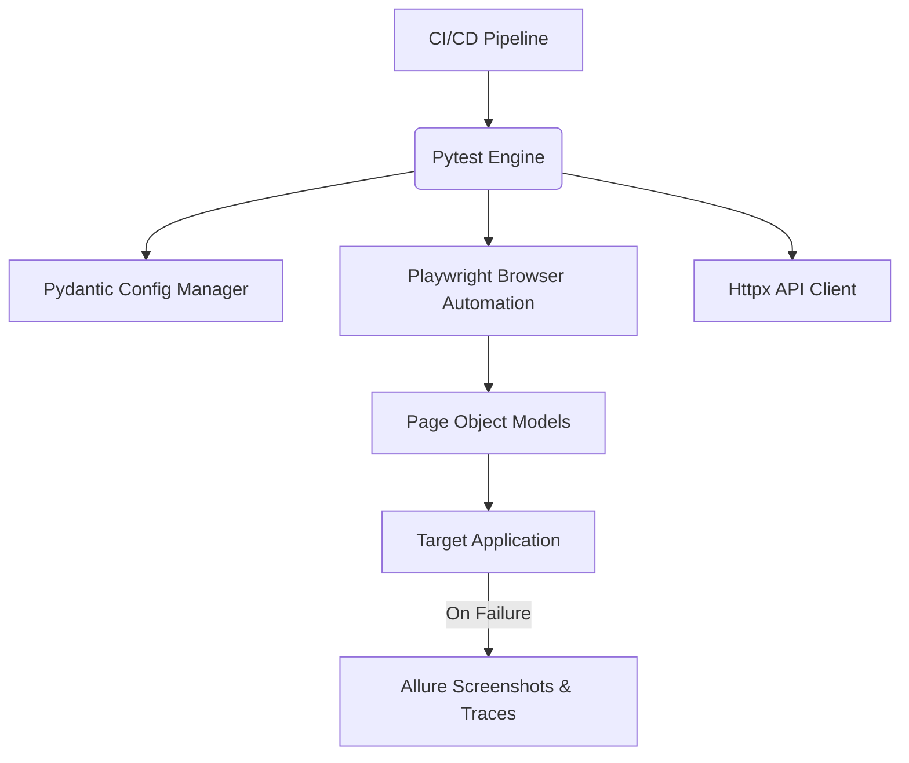

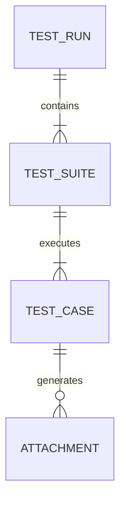

### Use & Audience
QA Engineers, SDETs, and DevOps personnel running automated pipeline checks.

### Setup & Command Execution
```bash
cd 01-advanced-qa-framework
pip install -r requirements.txt
playwright install
pytest -v --alluredir=reports/allure-results
```

### Pros & Cons
* **Pros:** Blazing fast execution; full API + UI hybrid capability.
* **Cons:** Requires Python typing proficiency.

### Limitations & Bugs
* OS font variances may trigger false positives during strict visual snapshot pixel comparisons.

---

# 2. AgriDetect: Multi-Crop Disease Detection Engine

[](https://fastapi.tiangolo.com/)
[](https://tensorflow.org/)

### Description
Client-server agricultural diagnostic system using an EfficientNetB0 deep learning backbone to identify plant leaf pathologies and OpenCV color-masking algorithms to estimate percentage leaf damage.

### Purpose
Assists farmers and agronomists with automated crop health triage and severity scoring.

### Features
* Multi-class classification across PlantVillage dataset species.
* Computer vision HSV damage severity calculation.
* Streamlit interactive UI + RESTful FastAPI endpoints.

### File Structure
```text
02-agridetect-crop-disease/
├── main.py               # FastAPI backend server
├── app_ui.py             # Streamlit dashboard UI
├── saved_crop_model.h5   # Trained CNN model weights
└── class_indices.json    # Taxonomy index map
```

### System Diagrams

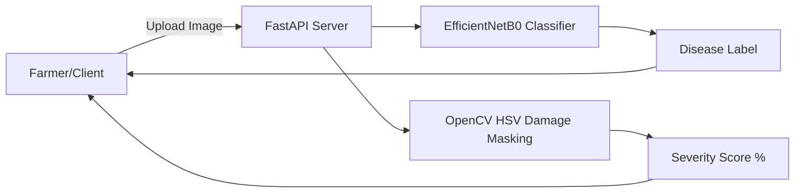

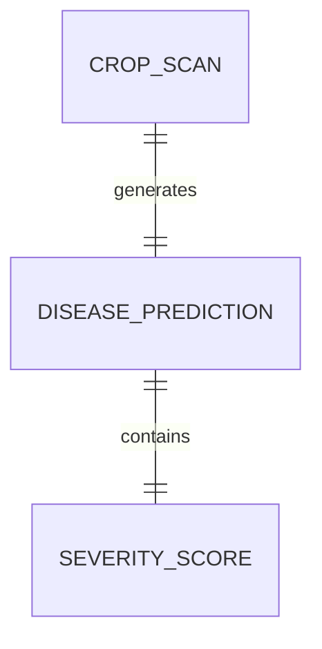

### Use & Audience
Agronomists, agricultural extension workers, and mobile app developers.

### Setup & Run
```bash
cd 02-agridetect-crop-disease
uvicorn main:app --reload
# In second terminal:
streamlit run app_ui.py
```

### Pros & Cons
* **Pros:** Quantifies physical damage instead of just outputting labels.
* **Cons:** Requires active backend server connection.

### Limitations & Bugs
* Extreme sunlight reflections can impact OpenCV color thresholding accuracy.

---

# 3. DocuChat AI — Enterprise PDF Intelligence Engine

[](https://python.langchain.com/)
[](https://ai.google.dev/)

### Description
A RAG (Retrieval-Augmented Generation) application enabling real-time conversational analysis across multi-page PDF documents using Google Gemini LLM and FAISS vector indices.

### Purpose
Eliminates manual document scanning for legal, financial, and academic researchers.

### Features
* Bring Your Own Key (BYOK) privacy model.
* Citation metadata linking responses directly to PDF page numbers.
* Multi-file workspace support.

### File Structure
```text
03-docuchat-ai/
├── src/
│   ├── pdf_loader.py    # PyPDF parser & text chunking
│   ├── vector_store.py  # FAISS index builder
│   └── qa_chain.py      # Gemini LLM LangChain prompt pipeline
└── app.py               # Main Streamlit web app
```

### System Diagrams

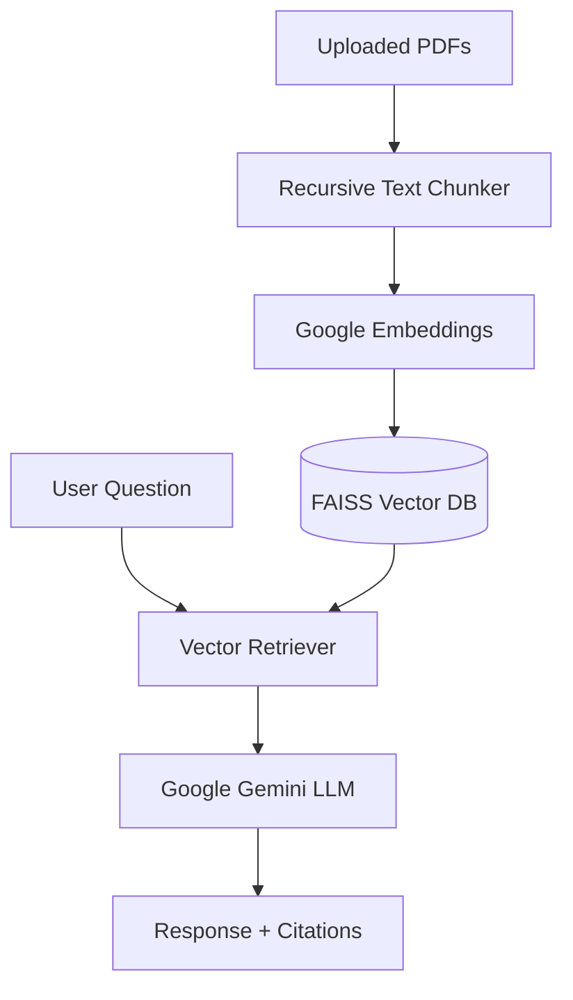

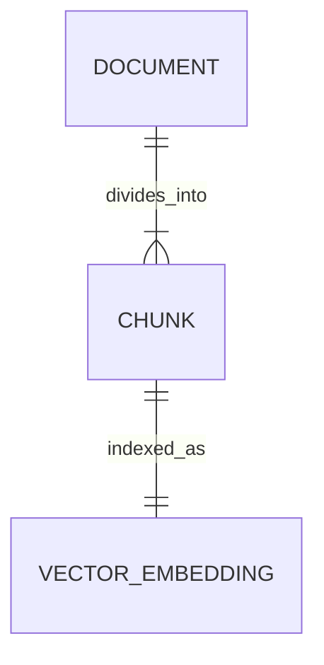

### Use & Audience
Legal analysts, medical researchers, students, and financial auditors.

### Setup & Run
```bash
cd 03-docuchat-ai
pip install -r requirements.txt
streamlit run app.py
```

### Pros & Cons
* **Pros:** Zero paid database hosting costs using in-memory FAISS.
* **Cons:** Re-upload required upon session reset.

### Limitations & Bugs
* Cannot parse image-only scanned PDFs without external OCR tools enabled.

---

# 4. Smart Attendance System (Pro Edition)

[](https://opencv.org/)
[](https://flask.palletsprojects.com/)

### Description
A browser-based student attendance management system utilizing HTML5 webcam streams, OpenCV Haar Cascade detection, and an embedded SQLite database.

### Purpose
Simplifies classroom attendance logging with real-time face detection and customizable reporting.

### Features
* Client-side HTML5 canvas frame streaming to prevent server latency.
* Advanced filters for tracking low-attendance (<75%) students.
* Customizable UI visual themes.

### File Structure
```text
04-smart-attendance-system/
├── app.py           # Flask server & SQLite ORM logic
├── attendance.db    # SQLite relational database
└── templates/
    └── index.html   # HTML5 webcam interface & analytics
```

### System Diagrams

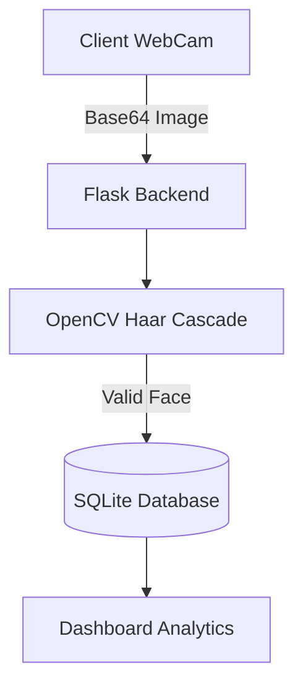

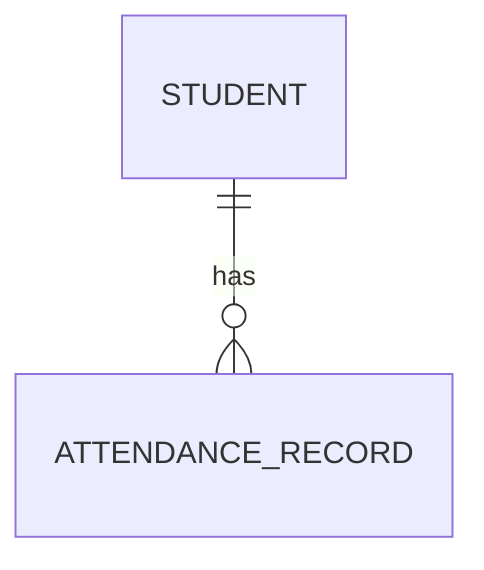

### Use & Audience
Teachers, school administration staff, and workshop instructors.

### Setup & Run
```bash
cd 04-smart-attendance-system
python app.py
```

### Pros & Cons
* **Pros:** Operates entirely locally without cloud subscription dependencies.
* **Cons:** Requires user confirmation to match facial detections to student profiles.

### Limitations & Bugs
* Browser camera access requires HTTPS if served outside of `localhost`.

---

# 5. Recruitment Analytics Platform & AI Resume Screener

[](https://streamlit.io/)
[](https://plotly.com/)

### Description
Dual-portal recruiting engine featuring an AI skill-matching resume scanner, salary/budget trackers, and an interactive Kanban hiring pipeline.

### Purpose
Accelerates talent acquisition for HR departments and small businesses.

### Features
* Dual views: Candidate Application Portal & HR Admin Dashboard.
* Automated percentage match scoring based on required tech stacks.
* Drag-and-drop recruitment stage tracking.

### File Structure
```text
05-recruitment-analytics-app/
├── app.py           # Streamlit app & SQLite engine
├── recruitment.db   # Local database
└── requirements.txt # Dependencies
```

### System Diagrams

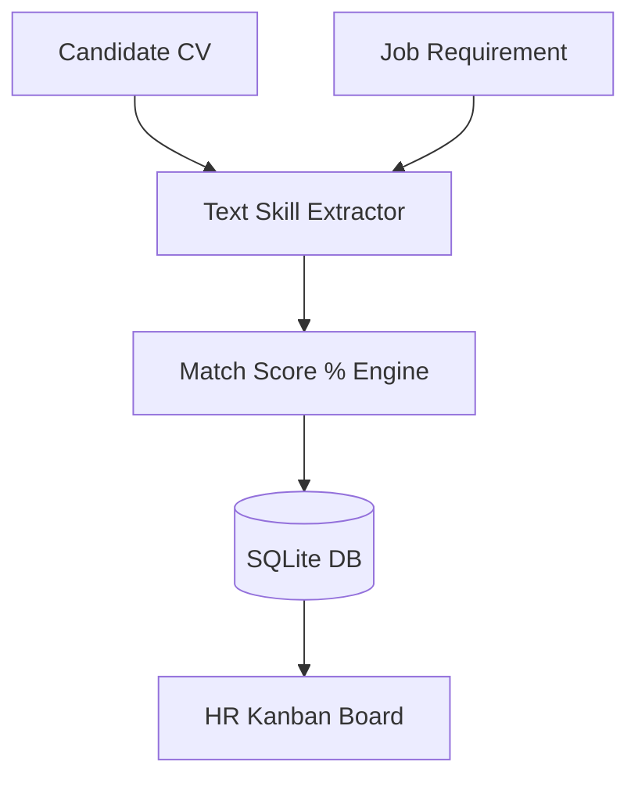

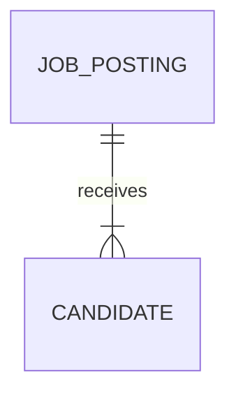

### Use & Audience
HR Managers, talent acquisition teams, and job applicants.

### Setup & Run
```bash
cd 05-recruitment-analytics-app
streamlit run app.py
```

### Pros & Cons
* **Pros:** Single-script deployment with zero database configuration.
* **Cons:** Uses keyword matching rather than deep contextual LLM embeddings.

### Limitations & Bugs
* Non-standard PDF CV formats may result in minor text extraction formatting issues.

---

# 6. Small Business ERP Lite

[](https://pandas.pydata.org/)

### Description
All-in-one business management application providing inventory tracking, safety reorder alerts, customer logs, sales recording, and revenue analytics.

### Purpose
Replaces disjointed spreadsheets with a single intuitive management dashboard for small retailers.

### Features
* Automatic safety stock warnings when inventory falls below thresholds.
* Live inventory updates triggered by sales transactions.
* Custom theme engine (Dark, Light, Cyberpunk).

### File Structure
```text
06-small-business-erp-lite/
├── app.py        # Streamlit ERP application
└── erp_lite.db   # SQLite database
```

### System Diagrams


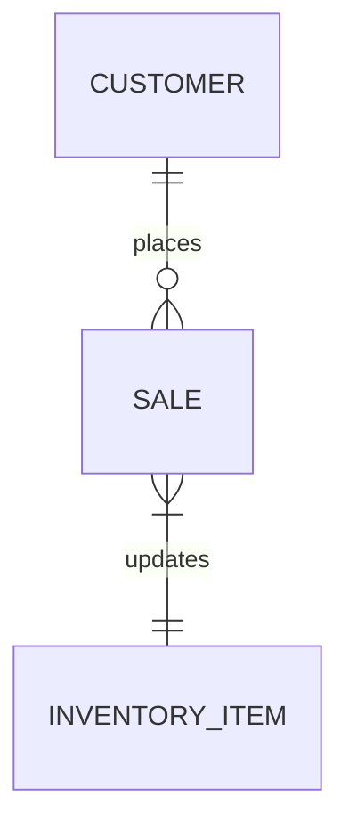

### Use & Audience
Small retail shop owners, boutique operators, and wholesalers.

### Setup & Run
```bash
cd 06-small-business-erp-lite
streamlit run app.py
```

### Pros & Cons
* **Pros:** Instant setup; handles sales, inventory, and analytics in one place.
* **Cons:** Lacks direct USB thermal receipt printer hardware drivers.

### Limitations & Bugs
* Simultaneous high-frequency write operations can cause SQLite file locks.

---

# 7. Event & Ticket Booking System

[](https://docs.python.org/3/library/tkinter.html)

### Description
A desktop application built with Python Tkinter for managing event schedules, attendee directories, ticket sales, and venue seating limits.

### Purpose
Provides event organizers with a self-contained offline ticketing control center.

### Features
* Built-in authentication and session security.
* Interactive Canvas-based analytical revenue breakdown.
* Dynamic interface theme switching.

### File Structure
```text
07-event-ticket-booking/
├── app.py               # Tkinter GUI & database handler
└── event_db.sqlite      # SQLite local database
```

### System Diagrams

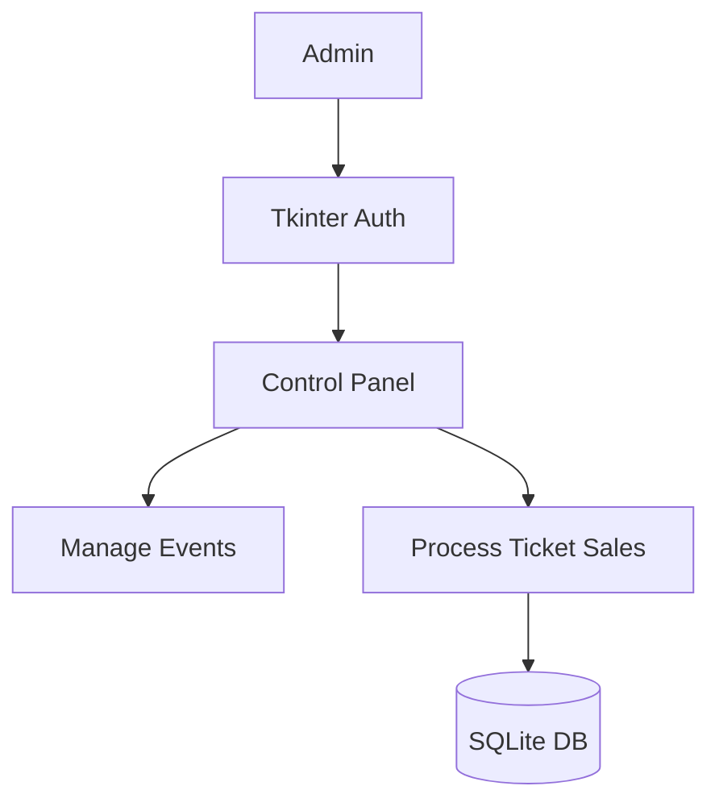

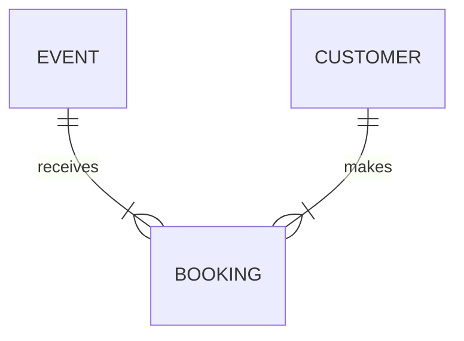

### Use & Audience
Event planners, theater managers, and conference hosts.

### Setup & Run
```bash
cd 07-event-ticket-booking
python app.py
```

### Pros & Cons
* **Pros:** Zero external web server dependencies; lightweight desktop executable.
* **Cons:** Desktop GUI lacks mobile web client browser access.

### Limitations & Bugs
* Native hardcoded fallback authentication credentials should be changed before production use.

---

# 8. The Life of a Flower (2D Simulation)

[](https://www.pygame.org/)

### Description
A 2D procedural animation created with Pygame and NumPy that renders the 4-stage lifecycle of a flower (**Seed**, **Grow**, **Bloom**, and **Wilt**) using pure mathematical curves.

### Purpose
Demonstrates math-driven procedural vector graphics and timing state machines without pre-rendered images.

### Features
* Smooth trigonometric growth scaling using `np.sin`.
* Real-time linear gradient background rendering.
* Dynamic decay color transformation during the wilt phase.

### File Structure
```text
08-life-of-a-flower/
└── flower_life_cycle.py  # Pygame main rendering loop
```

### System Diagrams

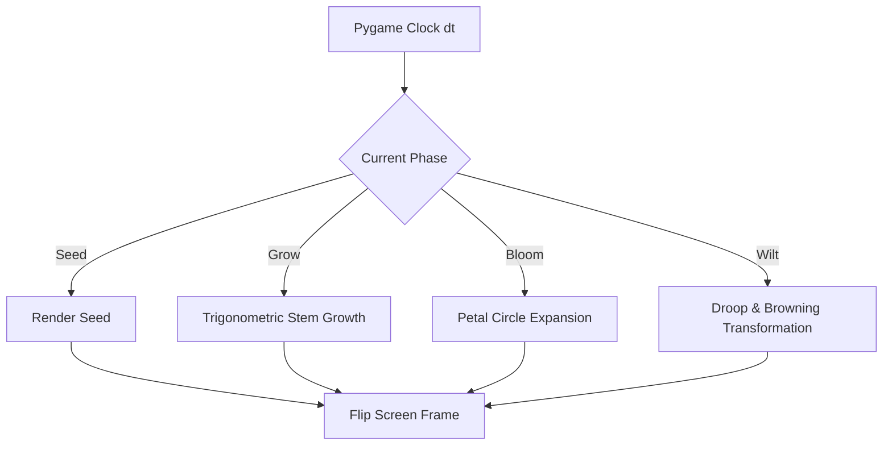

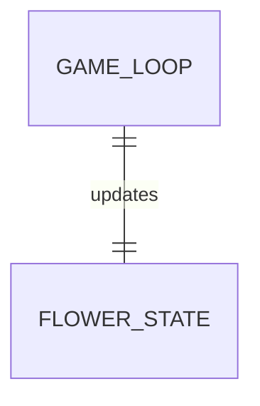

### Use & Audience
Game development students, creative coders, and math visualization enthusiasts.

### Setup & Run
```bash
cd 08-life-of-a-flower
python flower_life_cycle.py
```

### Pros & Cons
* **Pros:** 0 external PNG/JPG asset dependencies.
* **Cons:** CPU-bound line-by-line sky gradient loop.

### Limitations & Bugs
* High CPU usage may occur on older integrated graphics hardware during gradient loops.

---

# 9. Enterprise Sales Forecasting & Analytics System

[](https://scikit-learn.org/)

### Description
Machine learning forecasting engine using Scikit-Learn Random Forest Regressors to project multi-step temporal sales demand alongside 95% confidence intervals.

### Purpose
Empowers supply chain analysts to accurately forecast rolling revenue and inventory needs.

### Features
* Dynamic schema mapping for unformatted CSV/Excel uploads.
* Automated lag feature generation ($t-1, t-7, t-30$).
* Upper and lower statistical error bound projections.

### File Structure
```text
09-enterprise-sales-forecasting/
├── app.py                # Streamlit UI & ML pipeline
└── dummy_sales_data.csv  # Sample testing dataset
```

### System Diagrams

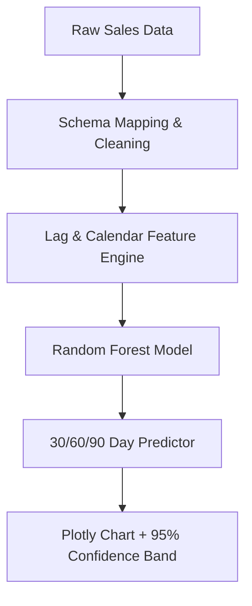

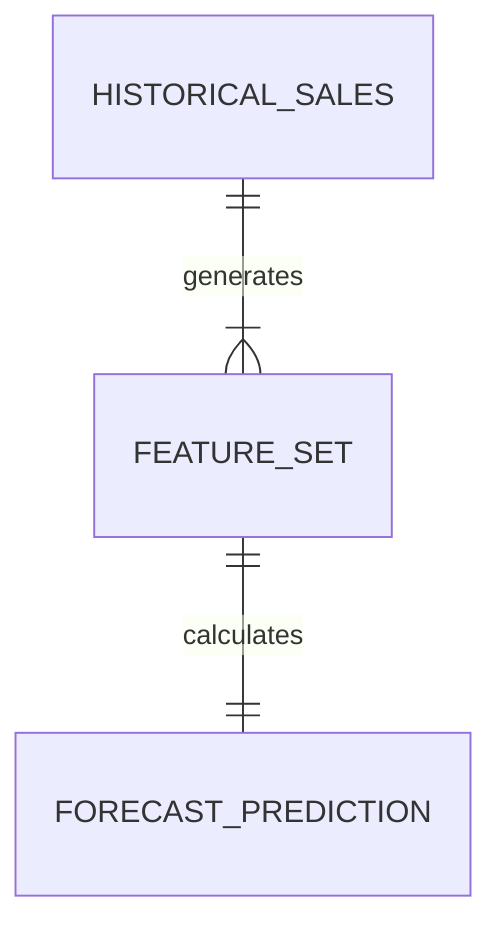

### Use & Audience
Supply chain managers, retail demand planners, and financial analysts.

### Setup & Run
```bash
cd 09-enterprise-sales-forecasting
streamlit run app.py
```

### Pros & Cons
* **Pros:** Ingests datasets with arbitrary column names via dynamic dropdown mapping.
* **Cons:** Tree-based models cannot extrapolate extreme linear trends far outside historical ranges.

### Limitations & Bugs
* Requires at least 60 continuous days of historical records to build valid 30-day lag features.

---

# 10. LogiTrack — Generative AI Logistics Enterprise Suite

[](https://python-visualization.github.io/folium/)

### Description
Integrated logistics platform featuring real-time spatial fleet maps, predictive maintenance telemetry, automated PDF Bill of Lading (BOL) creation, and driver-dispatcher chat logs.

### Purpose
Provides logistics CEOs and fleet managers with an all-in-one operations hub.

### Features
* Role-based access control (Admin/CEO, Driver, Client).
* Real-time spatial tracking with Folium map overlays.
* Automated PDF invoice generation upon shipment completion.

### File Structure
```text
10-logitrack-logistics-suite/
├── app.py          # Main Streamlit enterprise application
└── logistics.db    # Embedded SQLite database
```

### System Diagrams

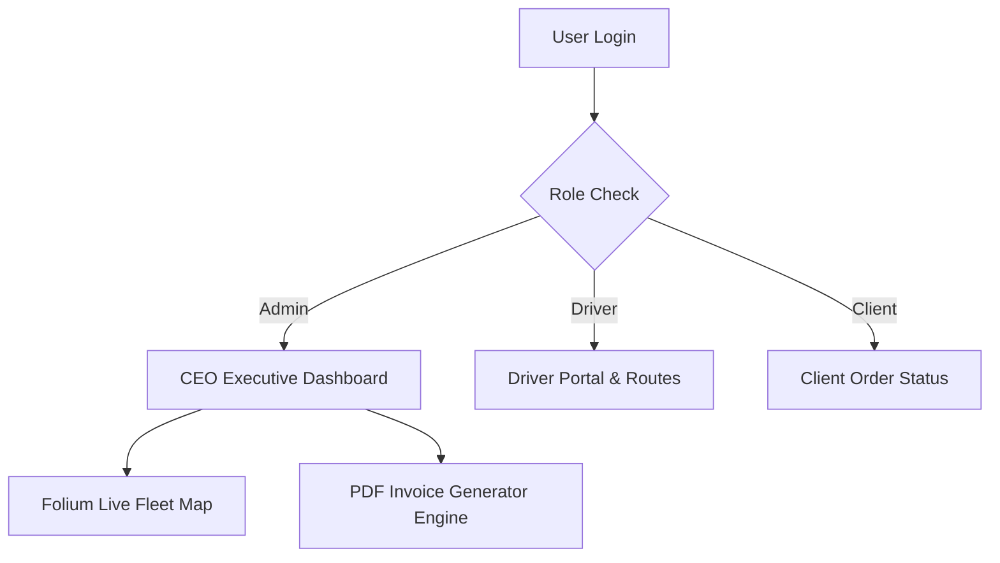

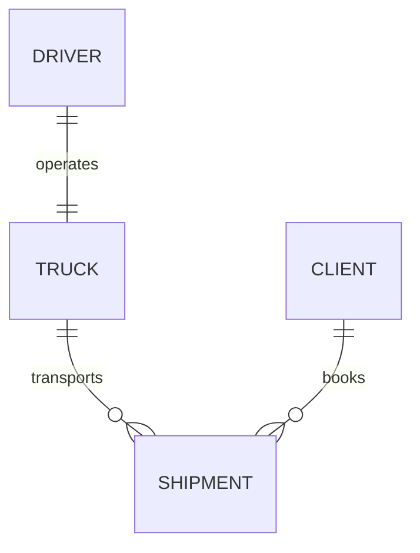

### Use & Audience
Logistics executives, fleet dispatchers, and freight delivery clients.

### Setup & Run
```bash
cd 10-logitrack-logistics-suite
streamlit run app.py
```

### Pros & Cons
* **Pros:** Covers end-to-end operational, financial, spatial, and communication workflows.
* **Cons:** GPS coordinates are simulated for demonstration purposes.

### Limitations & Bugs
* Plaintext authentication in demo mode should be upgraded to bcrypt for production hosting.

---

# 11. Single-Layer Perceptron AND Gate Implementation

[](https://www.python.org/)

### Description
A dependency-free Python implementation of an artificial single-layer perceptron neuron trained from scratch using forward propagation, mean squared error loss, and manual gradient descent.

### Purpose
Serves as an educational resource demonstrating raw neural network mechanics without external libraries.

### Features
* Zero dependencies; uses standard Python `math` and `random` libraries.
* Manual implementation of the Sigmoid activation derivative.
* Explicit epoch training logs.

### File Structure
```text
11-perceptron-and-gate/
└── perceptron_and_gate.py  # Neural network training code
```

### System Diagrams

```mermaid
graph LR
    X1[Input X1] --> Sum[Z = W1*X1 + W2*X2 + Bias]
    X2[Input X2] --> Sum
    Sum --> Act[Sigmoid Activation]
    Act --> Out[Output Prediction]
    Out --> Loss[Target Error Calculation]
    Loss --> Back[Backpropagation Weight Update]
```

```mermaid
erDiagram
    PERCEPTRON_MODEL ||--|{ TRAINING_SAMPLE : evaluates
```

### Use & Audience
Computer science students, AI/ML educators, and beginners learning backpropagation math.

### Setup & Run
```bash
cd 11-perceptron-and-gate
python perceptron_and_gate.py
```

### Pros & Cons
* **Pros:** Clear line-by-line demonstration of backpropagation.
* **Cons:** Single neurons cannot solve non-linearly separable problems like XOR.

### Limitations & Bugs
* Extreme parameter inputs could theoretically cause floating-point math overflow errors in `math.exp`.

---

# 12. Python Synthesizer & Yamaha-Style Workstation

[](https://www.pygame.org/)

### Description
Interactive audio workstation built with Tkinter, Pygame Mixer, and NumPy that synthesizes real-time sine wave audio with custom ADSR envelope decay and overtone harmonic blending.

### Purpose
Demonstrates digital signal processing (DSP) and real-time audio synthesis in Python.

### Features
* Dual computer keyboard and mouse input handling.
* Mixer controls for Master Volume, Decay Time, and Overtone Richness.
* Automated demo song player ("Ode to Joy").

### File Structure
```text
12-python-audio-synthesizer/
└── Advanced_UI_Piano.py  # GUI & NumPy DSP synthesizer
```

### System Diagrams

```mermaid
graph TD
    Input[Keyboard / Mouse Event] --> Freq[Calculate Note Frequency]
    Freq --> NumPy[NumPy Sound Wave Generator]
    NumPy --> Env[Apply Exponential Decay Envelope]
    Env --> Pygame[Pygame Audio Stream Channel]
    Pygame --> Speaker[Speaker Output]
```

```mermaid
erDiagram
    KEY_MAPPING ||--|| SYNTH_ENGINE : triggers
```

### Use & Audience
Audio engineers, Python graphics developers, and music technology enthusiasts.

### Setup & Run
```bash
cd 12-python-audio-synthesizer
python Advanced_UI_Piano.py
```

### Pros & Cons
* **Pros:** Algorithmically generates all sounds on the fly with zero `.wav` file assets.
* **Cons:** High overtone volume settings can cause digital clipping.

### Limitations & Bugs
* Rapid multi-key typing may occasionally leave key UI highlights active on loss of window focus.

---

# 13. AI Code Security Scanner

[](https://streamlit.io/)

### Description
A Static Application Security Testing (SAST) tool designed to scan Python codebases for security vulnerabilities, hardcoded API secrets, injection flaws, and unsafe execution functions.

### Purpose
Enables developers to identify and fix security flaws early in the software development lifecycle.

### Features
* Real-time metrics breakdown by severity (Critical, High, Medium, Low).
* Live interactive code editor with instant re-scanning capabilities.
* Inline remediation suggestions with copy-pasteable secure code replacements.

### File Structure
```text
13-ai-code-security-scanner/
├── app.py   # SAST dashboard & regex scanning engine
```

### System Diagrams

```mermaid
graph TD
    Code[Python Source Code] --> Engine[Pattern & Regex SAST Engine]
    Engine --> Triage{Check Severity}
    Triage -->|Critical/High| Card[Dashboard Vulnerability Alerts]
    Engine --> Fix[Remediation Code Generator]
    Card & Fix --> UI[Streamlit Inspector UI]
```

```mermaid
erDiagram
    SOURCE_FILE ||--|{ VULNERABILITY_FINDING : contains
```

### Use & Audience
Python developers, application security auditors, and DevSecOps practitioners.

### Setup & Run
```bash
cd 13-ai-code-security-scanner
streamlit run app.py
```

### Pros & Cons
* **Pros:** Runs entirely locally; keeps source code private without sending it to external APIs.
* **Cons:** Uses static regex matching rather than full AST taint tracking.

### Limitations & Bugs
* Scanning extremely large files (>10,000 lines) may temporarily slow down the Streamlit interface.

---

# 14. Urban Accessibility & "15-Minute City" Analyzer

[](https://osmnx.readthedocs.io/)
[](https://python-visualization.github.io/folium/)

### Description
Geospatial application built with GeoPandas, OSMnx, and Folium that computes metric spatial walking buffers and fetches OpenStreetMap (OSM) points of interest to measure urban walkability.

### Purpose
Helps urban planners evaluate infrastructure distribution and amenity accessibility.

### Features
* Global address geocoding powered by Nominatim.
* Geodesic metric buffering using local projected UTM coordinate reference systems.
* Dynamic amenity mapping (hospitals, schools, cafes, parks).

### File Structure
```text
14-urban-15min-city-analyzer/
├── app.py   # Streamlit spatial buffering application
```

### System Diagrams

```mermaid
graph TD
    Address[Target Location String] --> Geo[Nominatim Geocoder]
    Geo --> UTM[Convert Lat/Lon to Local UTM CRS]
    UTM --> Buffer[Shapely Metric Buffer Creator]
    Buffer --> OSM[OSMnx Overpass API Fetcher]
    OSM --> Map[Folium Leaflet Map Display]
```

```mermaid
erDiagram
    LOCATION ||--|{ AMENITY_POI : contains_within_buffer
```

### Use & Audience
Urban planning researchers, GIS data analysts, and local community organizers.

### Setup & Run
```bash
cd 14-urban-15min-city-analyzer
streamlit run app.py
```

### Pros & Cons
* **Pros:** Uses open infrastructure without requiring paid map API keys.
* **Cons:** Calculates radial distance ("as the crow flies") rather than exact street network paths.

### Limitations & Bugs
* Making multiple rapid search queries may trigger temporary Overpass API rate limits.

---

# 15. USB Virus Removal Tool

[](https://en.wikipedia.org/wiki/Batch_file)

### Description
An IT administrative script designed to remove USB shortcut malware, unhide hidden system files (`attrib -h -r -s`), remove `autorun.inf` entry points, and launch Microsoft Defender.

### Purpose
Restores files hidden by USB shortcut viruses on Windows machines.

### Features
* Validates target drive letters before execution.
* Restores file visibility using recursive attribute resets.
* Automatically triggers a Windows Defender custom scan.

### File Structure
```text
15-usb-virus-remover/
├── app.bat   # Main Windows Batch administrative script
```

### System Diagrams

```mermaid
graph TD
    Input[Admin Inputs Drive Letter] --> Val{Drive Exists?}
    Val -->|Yes| Del[Delete .lnk & autorun.inf]
    Del --> Attrib[Execute attrib -h -r -s /s /d]
    Attrib --> Def[Trigger PowerShell Defender Scan]
```

```mermaid
erDiagram
    USB_DRIVE ||--|{ FILE_ENTRY : contains
```

### Use & Audience
IT helpdesk technicians, system administrators, and Windows power users.

### Setup & Run
```cmd
cd 15-usb-virus-remover
:: Right click app.bat and select "Run as Administrator"
```

### Pros & Cons
* **Pros:** Lightweight script; runs natively without installing third-party tools.
* **Cons:** Compatible only with Windows environments.

### Limitations & Bugs
* Requires elevated Administrator privileges to modify system attributes.

---

# 16. Colorful YouTube Video Downloader

[](https://github.com/yt-dlp/yt-dlp)

### Description
A desktop downloader application built with Python Tkinter and `yt-dlp` that extracts videos (MP4) or standalone audio streams (MP3) without freezing the UI.

### Purpose
Provides a clean, ad-free alternative for downloading YouTube media.

### Features
* Asynchronous multithreaded worker pipeline to prevent UI locking.
* Real-time metrics display for download speeds, file sizes, and ETAs.
* Modern dark-mode interface.

### File Structure
```text
16-youtube-video-downloader/
├── main.py   # Tkinter UI & yt-dlp thread worker
```

### System Diagrams

```mermaid
graph TD
    URL[User Video URL] --> Thread[Background Worker Thread]
    Thread --> Engine[yt-dlp Engine]
    Engine --> Steam[Fetch Media Stream]
    Engine --> Hook[Progress Callback Hook]
    Hook --> GUI[Update Tkinter Progress Bar]
    Steam --> File[Save Output MP4/MP3 File]
```

```mermaid
erDiagram
    DOWNLOAD_JOB ||--|| OUTPUT_FILE : creates
```

### Use & Audience
Content creators, educators, and users needing offline media access.

### Setup & Run
```bash
cd 16-youtube-video-downloader
pip install yt-dlp
python main.py
```

### Pros & Cons
* **Pros:** Free of advertisements; keeps the GUI responsive during heavy downloads.
* **Cons:** Requires system-level FFmpeg installation for standalone MP3 conversion.

### Limitations & Bugs
* YouTube engine updates may occasionally require updating `yt-dlp` (`pip install -U yt-dlp`).

---

# 17. Power BI Enterprise Business Intelligence & Analytics Suite

[](https://powerbi.microsoft.com/)
[](https://docs.microsoft.com/en-us/dax/)

### Description
An enterprise Power BI solution featuring star-schema data modeling, custom DAX measures, time-intelligence calculations, and interactive dashboards covering Sales Operations, Executive Financials, and Customer Retention.

### Purpose
Transforms raw relational sales and financial databases into actionable business intelligence dashboards for executive teams.

### Features
* Star-schema data modeling with dedicated Date Dimensions (`Dim_Date`).
* Advanced DAX calculations (Year-over-Year Growth $\%$, Year-to-Date Revenue, Rolling 30-Day Moving Averages, Customer Lifetime Value).
* Interactive visual cross-filtering by Region, Product Category, and Sales Manager.
* Dynamic row-level security (RLS) configuration rules.

### File Structure
```text
17-powerbi-enterprise-analytics/
├── Enterprise_Executive_Dashboard.pbix   # Primary Power BI Dashboard File
├── data/
│   ├── Fact_Sales.csv                    # Sales transaction records
│   ├── Dim_Customer.csv                  # Customer demographic information
│   ├── Dim_Product.csv                   # Product catalog details
│   └── Dim_Region.csv                    # Geographic sales territories
└── README.md                             # Dataset overview & DAX measure catalog
```

### System Diagrams

```mermaid
graph TD
    RawCSV[Raw Enterprise CSVs] --> ETL[Power Query Data Transformation]
    ETL --> Model[Star Schema Relational Model]
    Model --> DAX[DAX Measure Engine]
    DAX --> YoY[YoY Growth & Moving Avg Metrics]
    DAX --> Visuals[Interactive Power BI Reports]
```

```mermaid
erDiagram
    Dim_Customer ||--o{ Fact_Sales : places
    Dim_Product ||--o{ Fact_Sales : contains
    Dim_Region ||--o{ Fact_Sales : occurs_in
    Dim_Date ||--o{ Fact_Sales : timestamped_at
```

### Key DAX Measures Included
```dax
// Total Revenue Measure
Total Revenue = SUM(Fact_Sales[SalesAmount])

// Prior Year Revenue Comparison
Revenue PY = CALCULATE([Total Revenue], SAMEPERIODLASTYEAR(Dim_Date[Date]))

// Year-over-Year Revenue Growth %
YoY Revenue Growth % = 
DIVIDE([Total Revenue] - [Revenue PY], [Revenue PY], 0)
```

### Use & Audience
Chief Financial Officers (CFOs), Sales Directors, and Business Intelligence Analysts.

### Setup & Usage Instructions
1. Download and install **[Power BI Desktop](https://powerbi.microsoft.com/desktop/)**.
2. Navigate to the `17-powerbi-enterprise-analytics/` directory.
3. Open `Enterprise_Executive_Dashboard.pbix` in Power BI Desktop.
4. If prompted to update data source paths, point the source files to the local `data/` directory.

### Pros & Cons
* **Pros:** Enterprise-grade interactive filtering and real-time executive visual KPI tracking.
* **Cons:** Requires Power BI Desktop installation (Windows environment recommended).

### Limitations & Bugs
* Sharing `.pbix` files directly requires a Power BI Pro or Premium workspace account for browser viewing.

---

## ⚖️ Portfolio Master Summary: Pros & Cons

| Dimension | Portfolio Strengths (Pros) 🟢 | Portfolio Trade-offs (Cons) 🔴 |
| :--- | :--- | :--- |
| **Tech Stack Coverage** | Spans Python, FastAPI, Flask, Streamlit, Pygame, Machine Learning, OpenStreetMap, Batch, and Power BI. | Higher overall system breadth than deep specialization in a single framework. |
| **Infrastructure Setup** | Most projects run zero-cost local database engines (SQLite, FAISS, in-memory arrays). | Multi-tenant cloud scaling requires decoupling embedded SQLite to managed cloud databases. |
| **Documentation & UX** | All 20 projects feature complete installation guides, system flow diagrams, and user interfaces. | Desktop applications (Tkinter/Batch) lack responsive web/mobile access. |

---

## 🔮 Future Master Roadmap & Updates

- [ ] **Unified Web Dashboard:** Build a single Next.js / FastAPI portal linking all 20 applications under a shared single sign-on (SSO) system.
- [ ] **Containerization:** Add individual `Dockerfile` configurations for all web microservices (AgriDetect, DocuChat AI, LogiTrack, Code Scanner).
- [ ] **Cloud Database Integration:** Migrate embedded SQLite database stores across projects to hosted PostgreSQL instances.
- [ ] **Expanded Power BI Service Sync:** Automate direct refresh pipelines connecting Streamlit ERP transaction logs directly into Power BI Service reports.

---

## 🤝 Contributing, Bugs & Vulnerabilities

### Security & Vulnerabilities Note
All code security scanning engines, automated QA frameworks, and batch cleanup scripts provided in this repository are designed for educational, developer audit, and administrative support purposes. Always review default database credentials before hosting publicly.

### How to Contribute
1. Fork the master repository.
2. Create a feature branch (`git checkout -b feature/NewAwesomeFeature`).
3. Commit your updates (`git commit -m 'Add NewAwesomeFeature'`).
4. Push to the branch (`git push origin feature/NewAwesomeFeature`).
5. Open a Pull Request for review.

---

## ⭐ Support, Thanks & Author Credits

Developed with ❤️ by **[Alok Kumar](https://github.com/alok--kumar8765)** (`alok--kumar8765`).

If this portfolio hub, its system architecture diagrams, or any of the 20 included applications provided value to you, please give this repository a **⭐ Star on GitHub**!

*Copyright © 2026 Alok Kumar (`alok--kumar8765`). Distributed under the MIT License.*