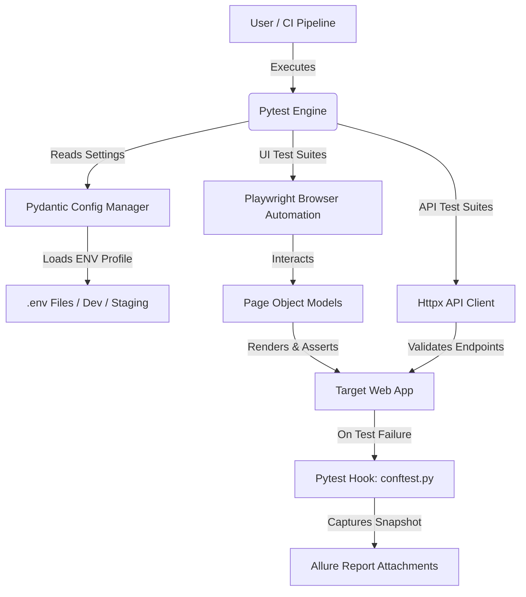

# 🚀 Enterprise-Grade Advanced Automated Testing Framework

[](https://www.python.org/)
[](https://docs.pytest.org/)
[](https://playwright.dev/python/)
[](https://allurereport.org/)
[](https://opensource.org/licenses/MIT)

An enterprise-ready, scalable test automation framework built with **Python, Pytest, Playwright, Pydantic, and Httpx**. It features Data-Driven Testing (DDT), hybrid UI/API verification, robust error handling, automated failure screenshot attachments, and rich Allure reporting integration.

---

## 📑 Table of Contents
1. [Overview](#-overview)
2. [Architecture & Folder Structure](#-architecture--folder-structure)
3. [System Flow & Data Flow Diagram (DFD)](#-system-flow--data-flow-diagram-dfd)
4. [Who Can Use It?](#-who-can-use-it)
5. [Setup & Installation Guide](#-setup--installation-guide)
6. [Execution Command Reference](#-execution-command-reference)
7. [Features](#-features)
8. [Pros & Cons](#-pros--cons)
9. [Limitations & Known Bugs](#-limitations--known-bugs)
10. [Future Roadmap & Updates](#-future-roadmap--updates)
11. [Author & Contributions](#-author--contributions)

---

## 🏛️ Architecture & Folder Structure

```text
advanced-qa-framework/
│
├── config/
│   ├── __init__.py
│   ├── settings.py            # Pydantic v2 environment configuration parser
│   └── environments/
│       ├── dev.env            # Development environment profile
│       └── staging.env        # Staging environment profile
│
├── core/
│   ├── __init__.py
│   ├── api_client.py          # Httpx-based backend API wrapper client
│   ├── base_page.py           # Encapsulated DOM actions & explicit waits
│   ├── driver_factory.py      # Isolated browser context & video/trace manager
│   └── logger.py              # Structured timestamped console & file logging
│
├── pages/
│   ├── __init__.py
│   ├── dashboard_page.py      # Post-login dashboard page object
│   └── login_page.py          # Authentication page object
│
├── test_data/
│   └── login_data.json        # Externalized data payloads for DDT
│
├── tests/
│   ├── __init__.py
│   ├── conftest.py            # Global Pytest fixtures, hooks & screenshot attachments
│   ├── test_api.py            # Backend API health & security tests
│   ├── test_auth.py           # Data-driven & standard UI authentication suites
│   └── test_visual.py         # Visual regression & UI render snapshot tests
│
├── reports/                   # Allure raw results & visual artifact storage
├── .env                       # Local runtime environment overrides
├── pytest.ini                 # Pytest engine configuration & markers
├── requirements.txt           # Python dependency manifest
└── README.md                  # Framework Documentation

```

---

## 📊 System Flow & Data Flow Diagram (DFD)



---

## 🎯 Who Can Use It?

* **QA Automation Engineers:** Seeking a clean, extensible, production-grade template rather than unstructured scripts.
* **DevOps & CI/CD Engineers:** Looking for a test harness that integrates out-of-the-box with GitHub Actions, Docker, and Allure reporting.
* **Software Developers in Test (SDETs):** Needing hybrid UI and API capabilities unified under a single test framework.

---

## 🛠️ Setup & Installation Guide

### Prerequisites

* **Python 3.11+** installed on your system.
* **Git** for cloning or managing repository versions.

### Step 1: Clone the Repository

```bash
git clone [https://github.com/alok-kumar8765/advanced-qa-framework.git](https://github.com/alok-kumar8765/advanced-qa-framework.git)
cd advanced-qa-framework

```

### Step 2: Set Up Virtual Environment

```bash
python -m venv venv
# Activate virtual environment:
# On Windows (CMD/PowerShell):
venv\Scripts\activate
# On macOS/Linux:
source venv/bin/activate

```

### Step 3: Install Dependencies & Binaries

```bash
pip install --upgrade pip
pip install -r requirements.txt
playwright install

```

### Step 4: Configure Environment Variables

Ensure your `.env` file exists in the root directory (or use profiles inside `config/environments/`). Example:

```env
ENV=dev
BASE_URL=[https://the-internet.herokuapp.com](https://the-internet.herokuapp.com)
BROWSER=chromium
HEADLESS=true
TIMEOUT=30000

```

---

## ⚡ Execution Command Reference

| Action | Command | Description |
| --- | --- | --- |
| **Run All Tests** | `pytest -v` | Executes the complete test suite sequentially. |
| **Run Headed Mode** | `pytest -v --browser chromium --headed` | Launches the browser visually during test execution. |
| **Parallel Execution** | `pytest -n auto` | Distributes tests across available CPU cores using `pytest-xdist`. |
| **Run Specific Suite** | `pytest tests/test_auth.py -v` | Runs only authentication-related tests. |
| **Run with Markers** | `pytest -m smoke` | Executes tests marked with specific pytest markers. |
| **Generate Allure Results** | `pytest --alluredir=reports/allure-results` | Outputs raw test results for Allure reporting dashboards. |

---

## 🌟 Key Features

* **Type-Safe Configuration:** Validates environment parameters at runtime via Pydantic.
* **Data-Driven Architecture:** Decouples test data (`test_data/login_data.json`) from test logic using parameterized fixtures.
* **Hybrid Testing Layer:** Combines high-speed backend API verification (`httpx`) with browser automation (`Playwright`).
* **Resilient Error Management:** Automatic full-page screenshot attachments on test failures routed directly into execution reports.
* **Structured Enterprise Logging:** Centralized logging format tracking execution steps, timelines, and response statuses.

---

## ✅ Pros & Cons

### Pros

* Extremely fast execution speeds compared to Selenium/WebDriver architectures.
* Clean separation of concerns (Core, Pages, Tests, Config).
* Native asynchronous and synchronous support.
* Highly portable and CI/CD friendly.

### Cons

* Requires familiarity with Python typing and modern assertion libraries.
* Browser binary installations (`playwright install`) require initial network access.

---

## ⚠️ Limitations & Known Bugs

* **Limitations:** Visual snapshot pixel comparisons can be sensitive to host operating system font rendering variances.
* **Known Bugs:** None currently reported in the core stable branch (`main`). Please open an issue if environmental socket timeouts occur under high parallelism (`-n auto`).

---

## 🔮 Future Roadmap

* [ ] Integration with Docker containers for isolated containerized test runs.
* [ ] Database fixtures (PostgreSQL/MySQL) for automated DB state setup and teardown.
* [ ] Advanced Allure Docker Service integration for automated CI report publishing.
* [ ] Mobile viewport emulation presets within the `DriverFactory`.

---

## 💡 Thanks & Star Contributions

Developed and maintained by **Alok Kumar** (`alok-kumar8765`).

If you find this framework useful for your enterprise projects, please consider giving the repository a ⭐ star on GitHub! Contributions, pull requests, and suggestions are always welcome.

---

*License: MIT © 2026 Alok Kumar (`alok-kumar8765`)*

