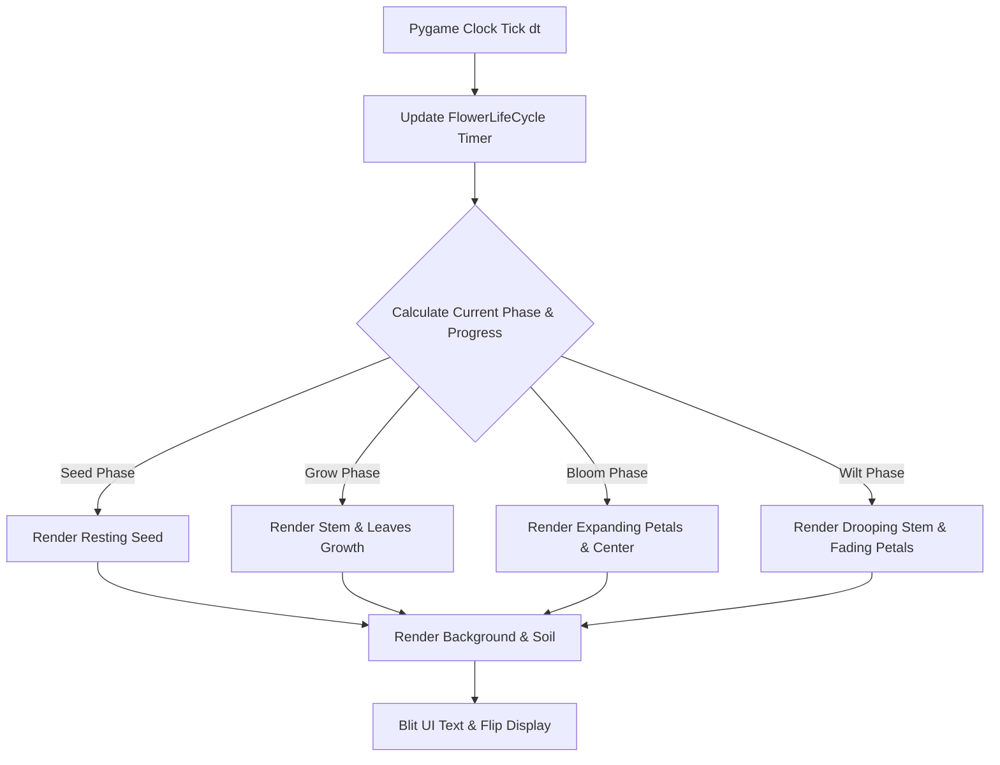
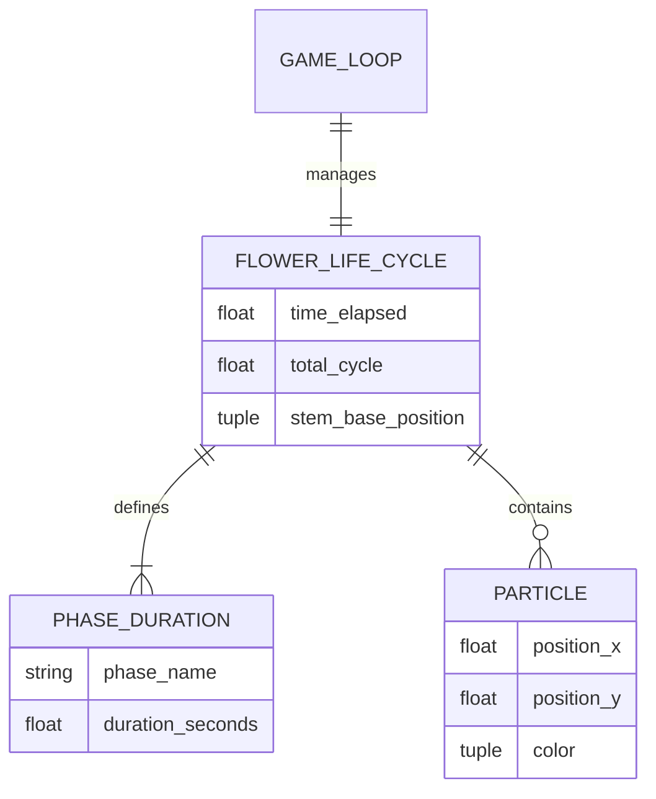

# The Life of a Flower 🌸


A smooth 2D procedural graphics animation built with **Pygame** and **NumPy** that simulates the natural lifecycle of a flower across four continuous phases: **Seed**, **Grow**, **Bloom**, and **Wilt**.

---

## 📋 Table of Contents
- [Description](#-description)
- [Purpose of This Project](#-purpose-of-this-project)
- [Features](#-features)
- [Requirements](#-requirements)
- [File Structure](#-file-structure)
- [Installation](#-installation)
- [Setup & How to Use](#-setup--how-to-use)
- [System Diagrams](#-system-diagrams)
  - [Data Flow Diagram (DFD)](#data-flow-diagram-dfd)
  - [Entity-Relationship (ER) Diagram / Model Representation](#entity-relationship-er-diagram--model-representation)
- [Who Can Use This & Use Cases](#-who-can-use-this--use-cases)
- [Pros and Cons](#-pros-and-cons)
- [Limitations](#-limitations)
- [Known Bugs & Vulnerabilities](#-known-bugs--vulnerabilities)
- [Future Updates](#-future-updates)
- [Contributing](#-contributing)
- [Star & Support](#-star--support)
- [Thanks](#-thanks)

---

## 📖 Description

**The Life of a Flower** is an interactive mathematical animation rendered in real time. It illustrates dynamic graphical transitions in 2D space:
- **Gradient Background rendering**: Sky and soil backdrop generated using linear color interpolation.
- **Trigonometric growth curves**: Easing curves (`np.sin`) applied to stem growth and petal expansion.
- **Color shifting**: Color transformation algorithms tracking petal decay during the wilt stage.

---

## 🎯 Purpose of This Project

The primary goal of this project is to showcase standard Python-based graphical rendering techniques, state machine management for animation timing, and procedural math applications for organic-looking visual animations without pre-rendered assets.

---

## ✨ Features

- **Automated Lifecycle Loop**: Seamless continuous transition across 12-second life cycles.
- **Procedural Graphics**: No external images or textures; all visuals are programmatically rendered vectors and shapes.
- **Trigonometric Easing**: Dynamic growth scaling using trigonometric mathematical curves.
- **Real-Time UI**: Live phase indicator with time tracking overlay.
- **60 FPS Framerate Lock**: Frame-rate independent animation driven by Pygame delta time (`dt`).

---

## 📦 Requirements

- **Python**: `3.8+`
- **Pygame**: `2.0+`
- **NumPy**: `1.20+`

---

## 📂 File Structure

```
life-of-a-flower/
├── flower_life_cycle.py    # Main script containing Pygame loop and dynamic graphics logic
├── README.md               # Project documentation
└── LICENSE                 # Open-source license
```

---

## 📥 Installation

Clone the repository to your local computer using Git:

```bash
git clone https://github.com/alok--kumar8765/life-of-a-flower.git
cd life-of-a-flower
```

Install the necessary dependencies:

```bash
pip install pygame numpy
```

---

## 🚀 Setup & How to Use

Run the main application using Python:

```bash
python flower_life_cycle.py
```

### Controls & Interface
- **Close Window (`X`)**: Exits the simulation cleanly.
- **Phase Text**: Top-left on-screen display showing current phase and time progress.

---

## 📊 System Diagrams

### Data Flow Diagram (DFD)



### Entity-Relationship (ER) Diagram / Model Representation



---

## 👥 Who Can Use This & Use Cases

- **Game Developers**: Reference example for state machines and procedural drawing.
- **Students & Educators**: Simple sample code for visual math (trigonometry in animation).
- **Python Beginners**: Clean code model for managing Pygame clock and event loops.

---

## ⚖️ Pros and Cons

### Pros
- **Zero Asset Dependencies**: Fast load times with 0 PNG/JPG assets required.
- **Clean Architecture**: Encapsulated state management logic.
- **Cross-Platform**: Runs seamlessly on Windows, macOS, and Linux.

### Cons
- **CPU Bound**: Line-by-line sky gradient loops draw directly via CPU CPU cycles rather than GPU shaders.
- **Non-Interactive**: Static auto-looping state without interactive user inputs.

---

## ⚠️ Limitations

- **Hardcoded Screen Size**: Native canvas fixed to $800 \times 600$ pixels.
- **Single Instance**: Simulates a single plant entity at a time.

---

## 🐛 Known Bugs & Vulnerabilities

- **Gradient Render Overhead**: Iterating line-by-line across screen height (`for y in range(HEIGHT - 150)`) every frame can increase CPU usage on lower-end hardware.

---

## 🔮 Future Updates

- [ ] Add interactive elements (watering can, daylight slider, wind strength).
- [ ] Implement Pygame Surface surfaces to pre-render the gradient background once.
- [ ] Add multiple dynamic seed spawns across the field.
- [ ] Introduce dynamic weather conditions (rain, sun, wind physics).

---

## 🤝 Contributing

Contributions are welcome!

1. Fork the repository.
2. Create a feature branch (`git checkout -b feature/AmazingFeature`).
3. Commit your changes (`git commit -m 'Add some AmazingFeature'`).
4. Push to the branch (`git push origin feature/AmazingFeature`).
5. Open a Pull Request.

---

## ⭐ Star & Support

If you enjoyed this procedural animation project, feel free to give the repository a **⭐ Star** on GitHub!

---

## 🙌 Thanks

Thanks to the open-source community behind **Pygame** and **NumPy**.

Developed with ❤️ by [alok--kumar8765](https://github.com/alok--kumar8765).